# Implémentation d'une Architectures pilôtées par les événements Patterns Event Sourcing & CQRS
### Auteur : Hafssa Miftah Idrissi
### Master : SDIA2
### Module : Systèmes distribués
### Année universitaire : 2026/2027

---
#### Introduction 

Implémentation pratique des patterns **Event Sourcing** et **CQRS** (Command Query Responsibility Segregation) avec **Spring Boot**, **Axon Framework** et **Axon Server**.

L'application de démonstration est un système de **gestion de comptes bancaires** : création et activation d'un compte, opérations de crédit et de débit, changement de statut, consultation du relevé et suivi en temps réel des transactions.

## Stack technique

| Technologie | Rôle |
|---|---|
| Java 21 | Langage |
| Spring Boot 3.4.3 | Framework applicatif (Web, Data JPA) |
| Axon Framework 4.10.3 | Command bus, Event Store, Query bus |
| Axon Server | Broker d'événements et Event Store distribué (gRPC) |
| PostgreSQL | Base de lecture et persistance de l'Event Store |
| Docker Compose | PostgreSQL, PgAdmin, Axon Server |
| Project Reactor | Streaming temps réel (Flux) |
| SpringDoc OpenAPI | Swagger UI pour tester l'API |
| Lombok | Réduction du code répétitif |

## Architecture

L'application est découpée selon les principes CQRS et Event Sourcing.

### Côté Commande (écriture)

1. Une requête REST arrive dans `AccountCommandController`.
2. Le `CommandGateway` envoie la commande (`send`).
3. L'agrégat `AccountAggregate` applique la **fonction de décision** : il vérifie les règles métier (solde positif, compte activé, solde suffisant) dans les `@CommandHandler`.
4. Il émet des événements via `AggregateLifecycle.apply()`, enregistrés dans l'**Event Store**.
5. L'état de l'agrégat est muté par la **fonction d'évolution** (`@EventSourcingHandler`).

### Côté Lecture (requêtes)

1. Les événements sont captés par `AccountEventHandler` (`@EventHandler`).
2. Ils sont projetés dans une base relationnelle dédiée à la lecture (entités JPA `Account` et `AccountOperation`).
3. Les requêtes de consultation passent par `AccountQueryController` et le `QueryGateway`.
4. `AccountQueryHandler` (`@QueryHandler`) lit les données projetées et retourne des DTOs.

### Temps réel (SSE)

Un endpoint `watch` retourne un `Flux<AccountOperation>` (Server-Sent Events). Le `QueryUpdateEmitter` pousse chaque nouvelle opération (crédit ou débit) vers le client dès qu'elle est projetée.

### Distribution avec Axon Server

L'application passe d'un Event Store en mémoire ou relationnel à **Axon Server**, qui centralise l'Event Store et achemine commandes, événements et requêtes via gRPC. Cela prépare une architecture distribuée en microservices.

## Modèle métier

**Commandes**
- `AddAccountCommand`
- `CreditAccountCommand`
- `DebitAccountCommand`
- `UpdateAccountStatusCommand`

**Événements**
- `AccountCreatedEvent`
- `AccountActivatedEvent`
- `AccountCreditedEvent`
- `AccountDebitedEvent`
- `AccountStatusUpdatedEvent`

**Requêtes**
- `GetAllAccountsQuery`
- `GetAccountStatementQuery`

## Structure du projet

```
src/main/java/ma/formation/...
├── commands
│   ├── aggregates      # AccountAggregate
│   ├── commands        # Commandes immuables
│   ├── controllers     # AccountCommandController
│   └── dto
├── events              # Événements du domaine
└── query
    ├── controllers     # AccountQueryController
    ├── entities        # Account, AccountOperation
    ├── handlers        # AccountEventHandler, AccountQueryHandler
    ├── queries
    └── repositories    # AccountRepository, AccountOperationRepository
```

## Prérequis

- JDK 21
- Maven 3.9.x
- Docker et Docker Compose

## Lancement

### 1. Démarrer l'infrastructure

```bash
docker compose up -d
```

Services lancés :
- PostgreSQL
- PgAdmin
- Axon Server (console sur http://localhost:8024)

### 2. Lancer l'application

```bash
mvn spring-boot:run
```

### 3. Tester l'API

Swagger UI : http://localhost:8080/swagger-ui.html

## Étapes de réalisation

1. **Initialisation** : projet Spring Boot (Web, Data JPA, PostgreSQL, Lombok), Axon Framework et SpringDoc. Exclusion temporaire de `axon-server-connector` pour démarrer avec un Event Store en mémoire.
2. **Command Side** : contrôleur, commandes, agrégat avec Command Handlers et Event Sourcing Handlers.
3. **Événements** : création des événements, sérialisation JSON via Jackson.
4. **Persistance** : `docker-compose.yml` avec PostgreSQL et PgAdmin, configuration de `application.properties`.
5. **Query Side** : entités JPA, repositories, projection des événements, requêtes et handlers de lecture.
6. **Temps réel** : Reactor Core, endpoint `watch`, `QueryUpdateEmitter`.
7. **Axon Server** : suppression de l'exclusion `axon-server-connector`, ajout du service dans Docker Compose, connexion via gRPC.

---

## Réalisations 

#### Initialisation du projet et dépendances
- Création d'un projet Spring Boot (Java 21) avec les dépendances Spring Web, Spring Data JPA, PostgreSQL et Lombok.
- Ajout de la dépendance Axon Framework et de SpringDoc OpenAPI (Swagger UI) pour tester les endpoints REST.
- Exclusion temporaire de axon-server-connector dans le fichier pom.xml pour démarrer d'abord avec un Event Store en mémoire.

#### Développements du Côté Commande (Command Side)
- Découpage par packages : Organisation du code en sous-packages (controllers, commands, dto, aggregates, events)
- Contrôleur de commande : Création d'un AccountCommandController injectant CommandGateway pour expédier les commandes (Send). Avec les méthodes : POST pour addNewAccount et ExceptionHandler pour l'affichage des exceptions, aussi POST pour le crédit d'un compte.
    <br> par exemple avant la création du Handler :
    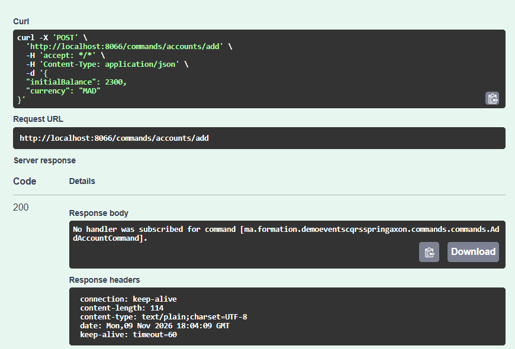
- Commandes : Implémentation des classes de commandes immuables (AddAccountCommand, CreditAccountComand)
- Agrégat (AccountAggregate) : Annoté avec @Aggregate et identifié par @AggregateIdentifier. Avec un constructeur sans paramètre pour l'Axon, une méthode CommandHandler pour faire l'écoute du bus pour les requetes de type commande dont après la vérification la fonction s'éxécute et utilise l'objet AggregateLifeCycle pour dispatcher les évenements.
- Création des événements: Création du Package events global pour les deux cotés (Commands & query) dont on crée des classes imuable avec @Getter et @AllArgsConstructor(AccountActivatedEvent, AccountCrreatedEvent, AccountCreditedEvent)
- Handler de l'Aggregat : Dans la classe AccountAggregate on ajoute une méthode hanlder de l'aggregat @EventSourcingHandler qui initialise l'état de l'aggregat et avec laquelle on poura récupérer l'état de l'aggregat à partir des évenements dispatchés dans l'event store et une autre @CommandHandler.
- Ajout de quelque log avec l'utilisation du @Slf4j su lombok dans l'AccountAggregat
    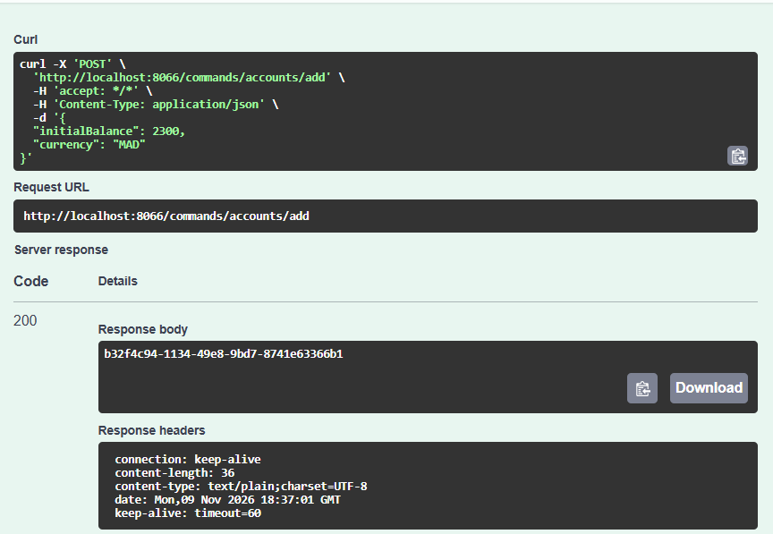
    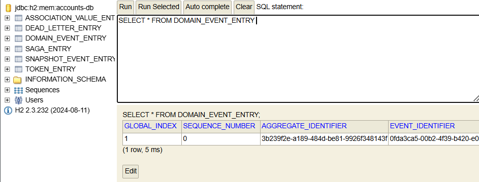
    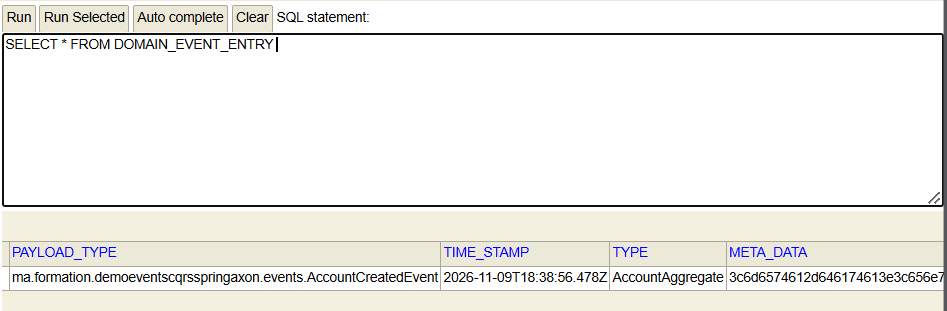
- Créditer un compte : meme principe se suit en commançant par la création de la méthode credit dans l'AccountCommandController puis un DTO CreditAccountRequestDTO qui créer une commande CreditAccountCommand et la dispatche, pour cette commande on crée un handler dans AccountAggregate et apply AccountCreditedEvent, on ajoute aussi à la commande un @EventSourcingHandler dans AccountAggregate. Cette fois à la création du compte on crée un event AccountCreatedEvent et un autre AccountActivatedEvent
    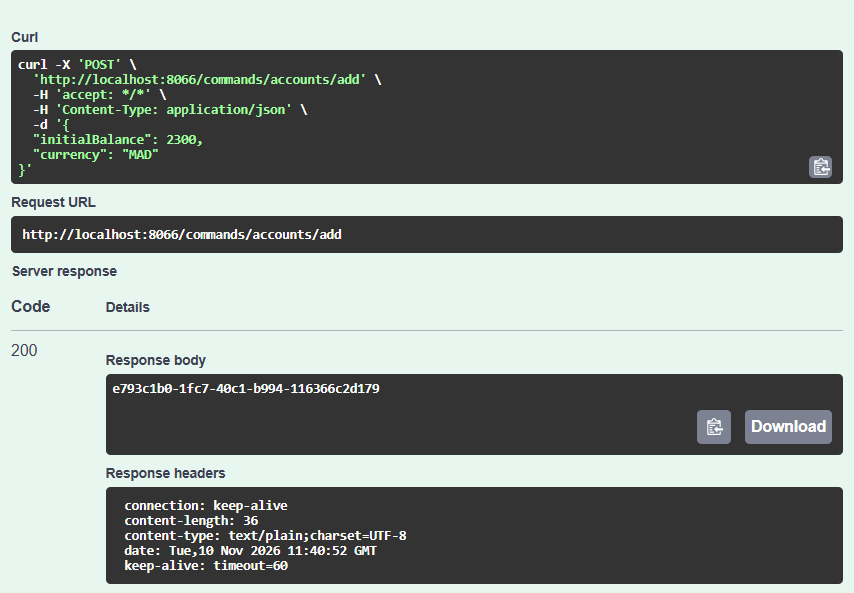
    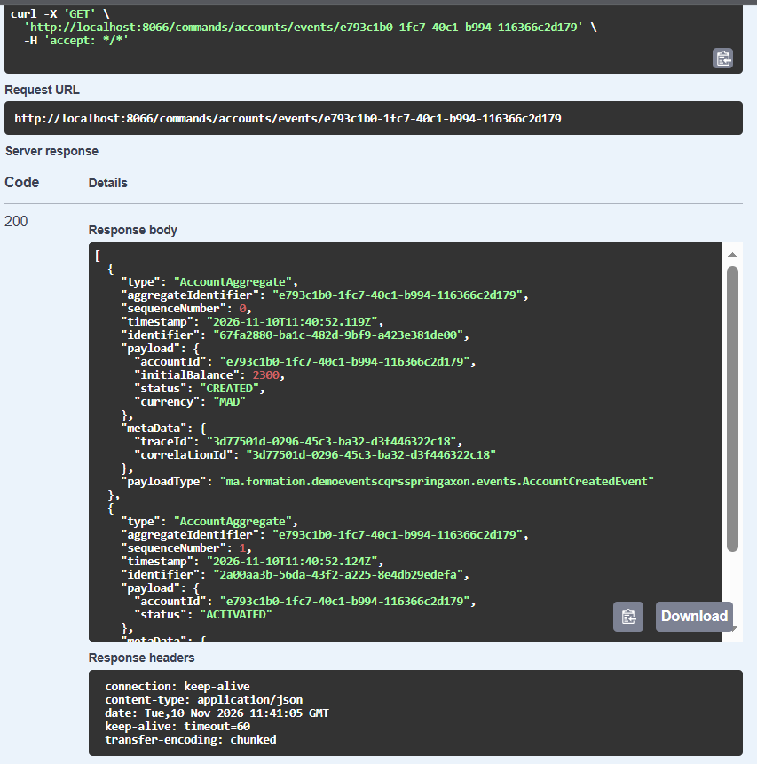
    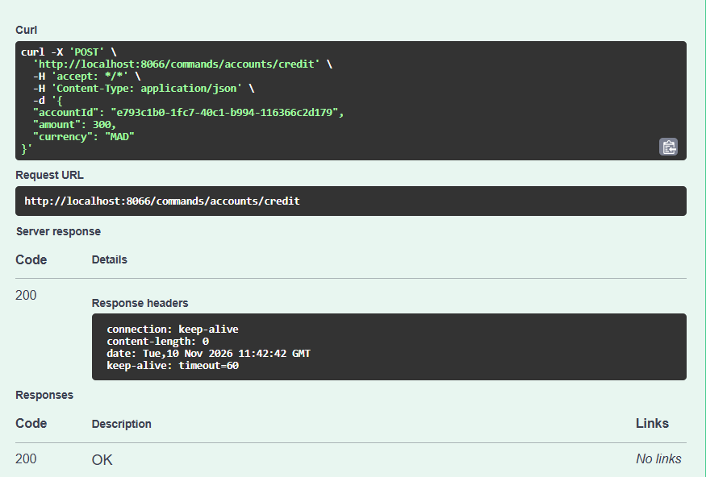
    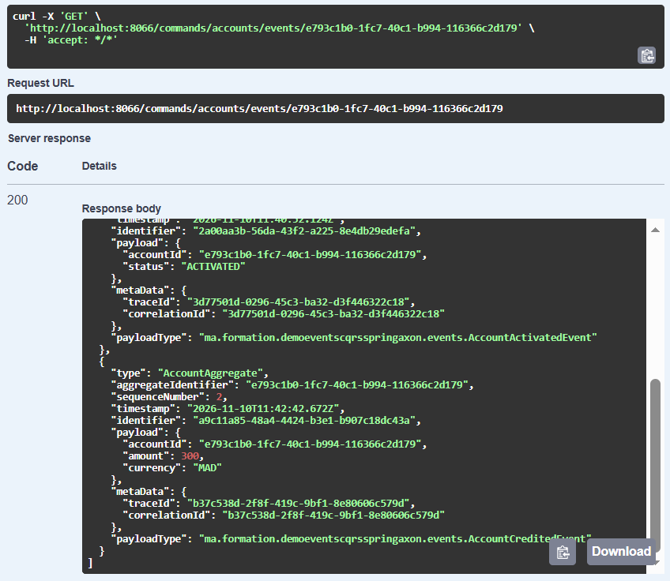
- Débiter un compte et changer le status d'un compte suivent le meme principe.
    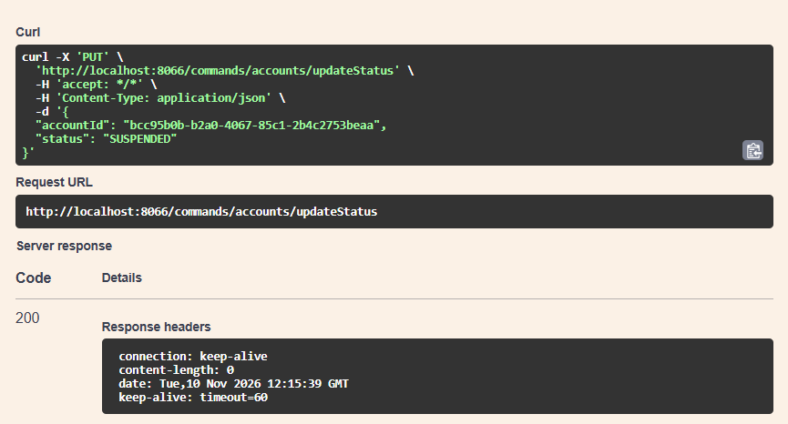
    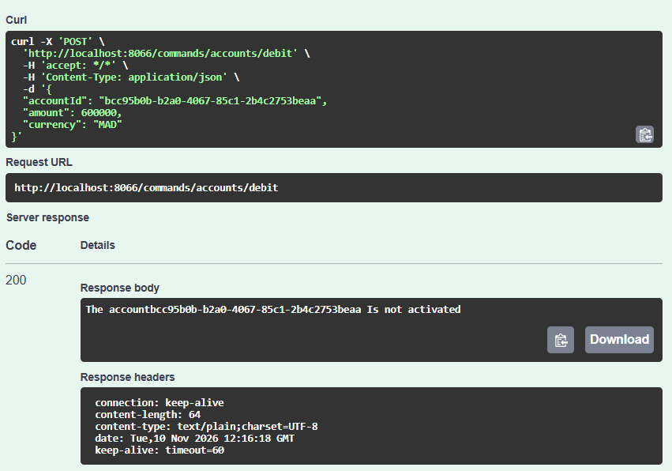
    
#### Implémentation des Événements (Events)
- Création des objets d'événements (AccountCreatedEvent, AccountActivatedEvent, AccountCreditedEvent, AccountDebitedEvent, AccountStatusUpdatedEvent).
- Configuration de la sérialisation du payload des événements en format JSON via Jackson.
  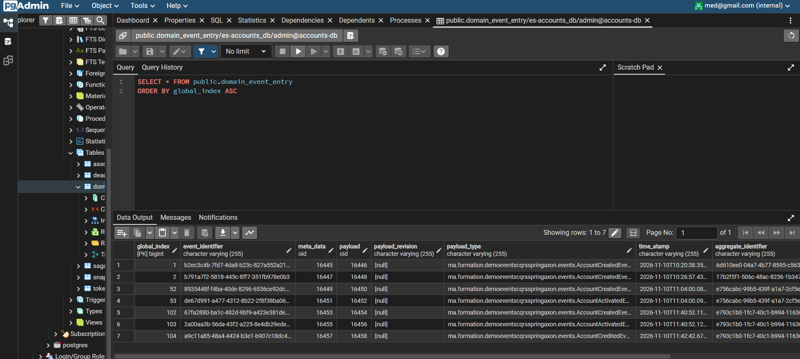

#### Persistance avec PostgreSQL et Docker Compose
- Création d'un fichier docker-compose.yml pour lancer un conteneur PostgreSQL et PgAdmin.
- Configuration du application.properties pour basculer la source de données vers PostgreSQL et conserver l'historique de l'Event Store.
    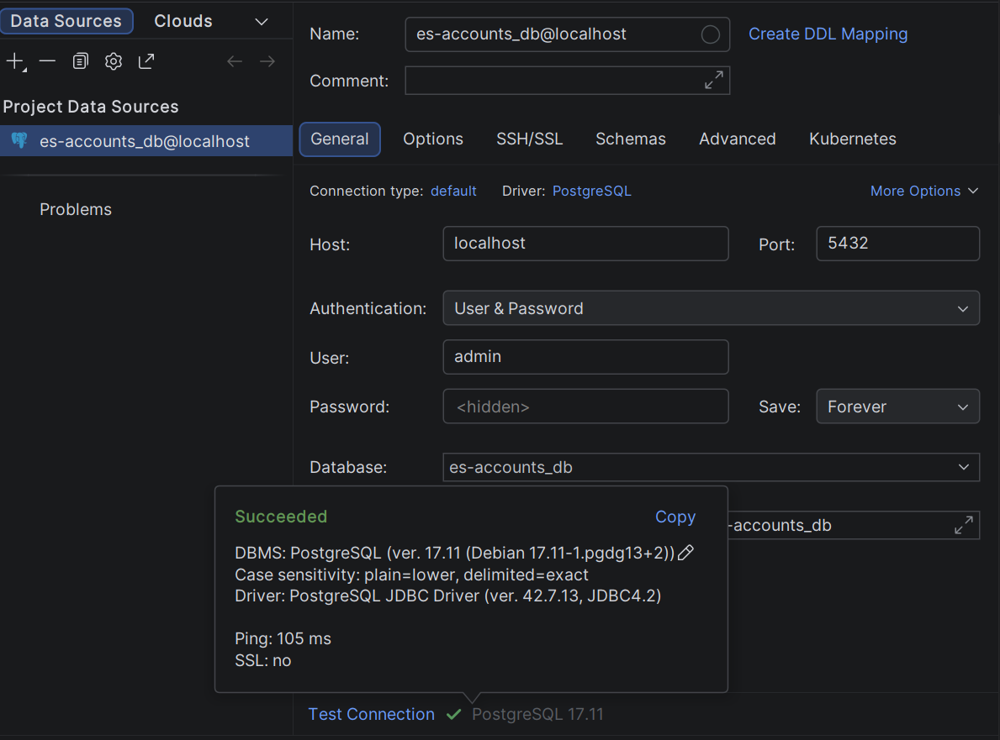
    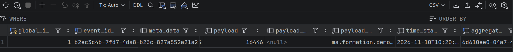
    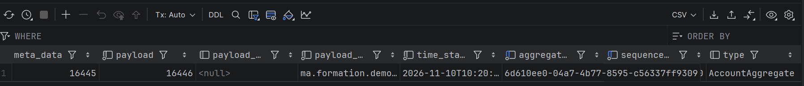
  * Test avec une méthode event store qui cherche dans l'event store tous les événements qui concernent un aggregat identifié par aggregate identifier <br>
    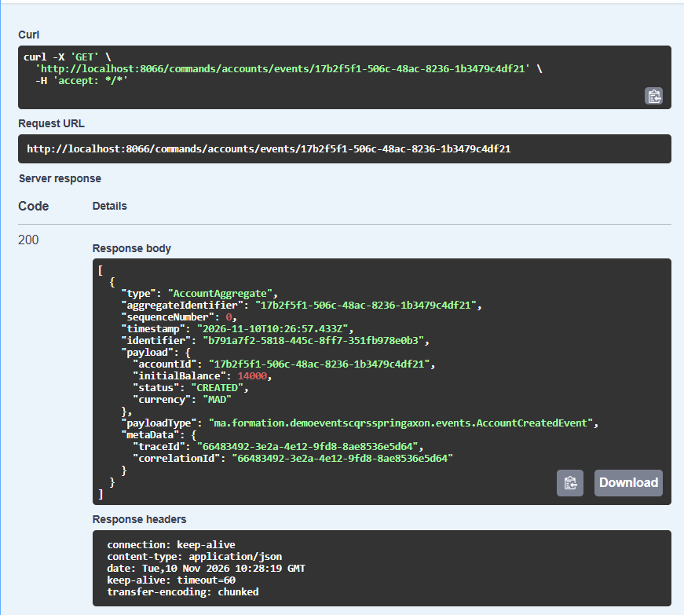

#### Développements du Côté Lecture (Query Side)
- Création des entités Account et AccountOperation ainsi que de leurs interfaces Spring Data AccountRepository et AccountOperationRepository.
- Création d'un AccountEventHandler annoté @EventHandler qui écoute les événements de l'Event Store et met à jour la base de lecture relationnelle.
- 
---
## Référence

Projet réalisé dans le cadre d'un TP, en suivant une démonstration vidéo de l'enseignant.